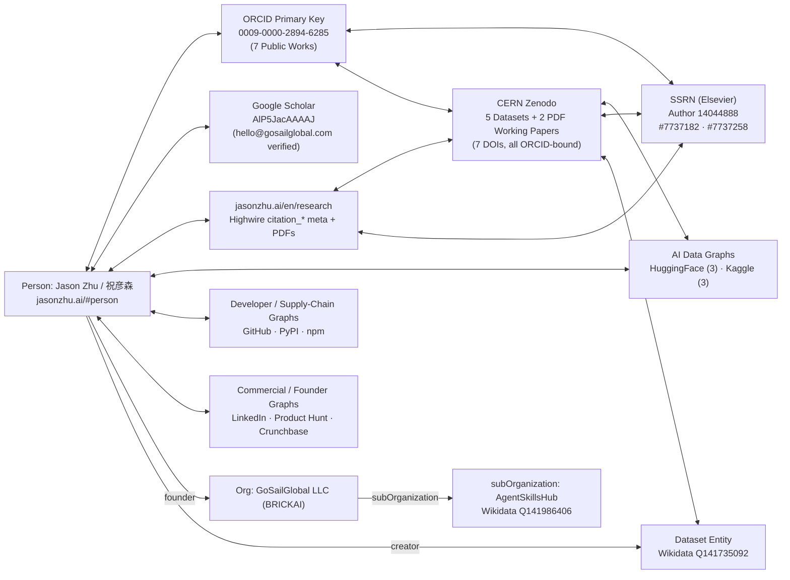

# Entity Graph Infiltration Playbook (实体入侵外部知识图谱方法论与实操 SOP)

> **Author / Owner:** Jason Zhu (Yansen Zhu · 祝彦森) · ORCID [`0009-0000-2894-6285`](https://orcid.org/0009-0000-2894-6285)  
> **Canonical Entity Homes:** [`jasonzhu.ai/en`](https://jasonzhu.ai/en) · [`agentskillshub.top`](https://agentskillshub.top)  
> **Version:** v2.1 (2026-11-21)  
> **Scope:** Repeatable engineering playbook for infiltrating Google Knowledge Graph, Bing/ChatGPT Entity Graph, Perplexity RAG, OpenAlex, Semantic Scholar, and Google Scholar—from zero-cost original datasets to permanent KGMID & citation compounding.

---

## 1. Core Mechanism: How Major Knowledge Graphs Decide Whom to Trust

Search engines and AI answer engines do **not** trust self-proclaimed JSON-LD on an isolated domain. Every major knowledge graph executes a 5-stage ingestion pipeline:

```text
1. Discovery            -> Crawlers find an entity + original facts on an Entity Home
2. Entity Resolution    -> Deduplicate same-name collisions via immutable global primary keys (ORCID, DOI, QID)
3. Relation Extraction  -> Parse strict typed triples (Person -founder-> Org -subOrganization-> Product; Person -creator-> Dataset)
4. Multi-Source Loop    -> Verify bidirectional corroboration (A -> B AND B -> A) across 6+ independent high-DR graphs
5. Citation Weighting   -> Rank entity authority by third-party inbound citations, academic indexes, and temporal freshness
```

**Cardinal Rule:** Without **original empirical facts** (first-hand census datasets, itemized fee benchmarks, security audits), external graphs will not mint durable authority around your entity. Data is the payload; persistent identifiers and bidirectional links are the delivery vehicle.

---

## 2. Live Entity Graph Topology (v2 State — Verified 2026-11-21)



---

## 3. Baseline (v1) vs. Executed Upgrades (v2) Ledger

### What v1 Already Had (Baseline)
- 4 original empirical datasets (200k indie checkout links, \$20 MoR subscription fees, 105K/130K AI agent skills security audit, 581 backlink-spam doorway domains).
- Dual Entity Homes (`jasonzhu.ai`, `agentskillshub.top`) with initial JSON-LD and `/llms.txt`.
- Scattered external nodes: 5 Zenodo CSV records (no ORCID, no PDF), Wikidata `Q141986406` & `Q141735092`, GitHub, PyPI `backlink-guard`, npm `@agentskillshub/*`, Crunchbase, dev.to.

### Critical KG Defects Fixed in v2 (2026-11-21)

| Layer | v1 Defect | v2 Fix Shipped & Verified | Live Anchor / Evidence |
| :--- | :--- | :--- | :--- |
| **1. Primary Key & Disambiguation** | `Jason Zhu` collided with medical/chemistry scholars & `Jason (Siyu) Zhu`; CN `祝彦森` and EN `Jason Zhu` were split. | Minted **ORCID** (`0009-0000-2894-6285`), verified **Google Scholar** (`AlP5JacAAAAJ`) via `hello@gosailglobal.com` unifying 2019 CN papers + 2026 EN research with zero medical misattribution, and OAuth-bound **SSRN** (`14044888`). | [ORCID](https://orcid.org/0009-0000-2894-6285) · [Scholar](https://scholar.google.com/citations?user=AlP5JacAAAAJ) · [SSRN](https://papers.ssrn.com/sol3/cf_dev/AbsByAuth.cfm?per_id=14044888) |
| **2. Typed Triples & Schema Hygiene** | `/en` JSON-LD leaked Chinese copy; Person/Org/Product/Dataset collapsed into one `sameAs`; dead Wikidata QID present. | Rewrote `layout.tsx`, `profiles.ts`, and `agentskillshub.top` schema: explicit `Person -founder-> GoSailGlobal LLC -subOrganization-> AgentSkillsHub (Q141986406)` and `Person -creator-> Dataset (Q141735092)`; removed dead QID. | `src/app/[lang]/layout.tsx` · `src/lib/profiles.ts` |
| **3. 9-Graph Bidirectional Corroboration** | One-way outbound links from main site only; HF/Kaggle incomplete. | Back-wrote ORCID into **5/5 Zenodo datasets**; completed **3/3 HuggingFace** and **3/3 Kaggle** datasets with ORCID+DOI+URL anchors; updated GitHub profile/repo, Product Hunt (`@yansen_zhu`), LinkedIn, and PyPI `pyproject.toml`. | [HF](https://huggingface.co/jasonzhuyansen) · [Kaggle](https://www.kaggle.com/yansenzhu) · [PH](https://www.producthunt.com/@yansen_zhu) · [GitHub](https://github.com/zhuyansen) |
| **4. Scholarly PDF Crawler Ingestion** | Bare CSVs on Zenodo are skipped by Google Scholar / OpenAlex paper crawlers. | Typeset 2 formal Typst academic Working Paper PDFs (10p + 7p), published to **CERN Zenodo (`workingpaper`)** + **SSRN (CC BY)** + hosted at **`jasonzhu.ai/en/research/[slug]`** with Highwire Press `citation_*` meta tags & BibTeX. | [Paper 1 Zenodo](https://doi.org/10.5281/zenodo.24420871) · [SSRN #7737182](https://papers.ssrn.com/sol3/papers.cfm?abstract_id=7737182) · [Paper 2 Zenodo](https://doi.org/10.5281/zenodo.24420920) · [SSRN #7737258](https://papers.ssrn.com/sol3/papers.cfm?abstract_id=7737258) |

---

## 4. Repeatable Academic Publishing SOP (Zero-Fee Google Scholar Ingestion)

Whenever a new flagship empirical study is published on `jasonzhu.ai`, run this 25-minute pipeline so it enters academic + AI search indexes automatically:

1. **Typeset Academic Working Paper PDF with Typst (6–10 pages)**
   - Source templates: `ops/geo/papers/Zhu-2026-*.typ`
   - Required sections for Google Scholar / SSRN acceptance: Title (no hyphenation), Author + Affiliation + ORCID, Formal Abstract, Keywords + JEL/ACM Codes, Numbered Sections, Methodology + Equations/Tables, Limitations, Open Data Availability (DOIs + mirrors), Formal References.
   - Compile: `typst compile --root /Users/zhuyansen/出海/jasonzhu.ai ops/geo/papers/<name>.typ ops/geo/papers/<name>.pdf`
   - Copy PDF to `public/papers/<name>.pdf` and add an entry in `src/lib/research.ts` (automatically creates `/[lang]/research/[slug]` with `citation_pdf_url` & `ScholarlyArticle` JSON-LD).
2. **Publish to CERN Zenodo as `publication` / `workingpaper`**
   - Set `creators[].orcid = "0009-0000-2894-6285"`, `license = "cc-by-4.0"`, and `related_identifiers` linking underlying dataset DOIs (`isSupplementedBy`) + canonical blog URL.
   - Add the minted DOI into ORCID (`working-paper`) via ORCID UI/API.
3. **Submit to SSRN (Elsevier)**
   - Upload PDF (`Preprint`, `CC BY`), verify extracted Title/Abstract/Date/Keywords, choose 3–6 leaf eJournal classifications, fill transparent Declaration of Interest & self-funded Funder Statement, submit and record the permanent `abstract_id`.
4. **Sync Bidirectional Links**
   - Append SSRN `abstract_id` + Zenodo Working Paper DOI into `src/lib/profiles.ts`, `src/lib/research.ts`, and `zhuyansen/zhuyansen/README.md`.

---

## 5. Complete Live Asset Inventory (All Persistent Anchors)

### Author & Brand Entity Nodes
- **Entity Home (EN/ZH):** `https://jasonzhu.ai/en` · `https://jasonzhu.ai/en/research`
- **ORCID:** `https://orcid.org/0009-0000-2894-6285`
- **Google Scholar:** `https://scholar.google.com/citations?user=AlP5JacAAAAJ`
- **SSRN Author Page:** `https://papers.ssrn.com/sol3/cf_dev/AbsByAuth.cfm?per_id=14044888`
- **LinkedIn (Personal / Company):** `https://www.linkedin.com/in/jason-zhu-a52aa73bb/` · `https://www.linkedin.com/company/gosailglobal/`
- **Product Hunt:** `https://www.producthunt.com/@yansen_zhu`
- **GitHub:** `https://github.com/zhuyansen`
- **Hugging Face:** `https://huggingface.co/jasonzhuyansen`
- **Kaggle:** `https://www.kaggle.com/yansenzhu`
- **Wikidata Entities:** AgentSkillsHub (`https://www.wikidata.org/wiki/Q141986406`) · 130K Dataset (`https://www.wikidata.org/wiki/Q141735092`)
- **Crunchbase:** `https://www.crunchbase.com/organization/agent-skills-hub`
- **PyPI / npm:** `https://pypi.org/project/backlink-guard/` · `@agentskillshub/cli` · `@agentskillshub/mcp`

### Working Papers (PDF) & Open Datasets (All CC-BY-4.0)
| Artifact | Zenodo DOI | SSRN / Mirrors |
| :--- | :--- | :--- |
| **Working Paper #1 (10p PDF):** 200K Indie Payments & \$20 MoR Shift | `10.5281/zenodo.24420871` | SSRN `#7737182` · `jasonzhu.ai/en/research/indie-saas-payments-mor-shift-2026` |
| **Working Paper #2 (7p PDF):** 105K+ AI Agent Skills & MCP Security | `10.5281/zenodo.24420920` | SSRN `#7737258` · `jasonzhu.ai/en/research/ai-agent-skills-mcp-supply-chain-security-2026` |
| **Dataset 1:** 200K Indie Checkout Links (2023–2026) | `10.5281/zenodo.24386243` | GitHub · HF · Kaggle |
| **Dataset 2:** \$20 MoR Cross-Border Fee Benchmark | `10.5281/zenodo.24387072` | GitHub · HF · Kaggle |
| **Dataset 3:** 105K AI Agent Skills Supply-Chain Audit | `10.5281/zenodo.24387074` | HF · Kaggle · `agentskillshub.top/how-we-grade/` |
| **Dataset 4:** 581 Backlink Spam Doorway Domains | `10.5281/zenodo.24387076` | GitHub · HF · Kaggle · PyPI `backlink-guard` |
| **Dataset 5:** 130K AI Agent Skills Security Grades | `10.5281/zenodo.21292799` | Wikidata `Q141735092` · HF · Kaggle |

---

## 6. v3 Optimization Roadmap (From 90% Static Skeleton to Citation Dominance)

### Phase 1: Final Skeleton Polish (Immediate / Same-Day)
- [x] **SSRN Affiliation:** Added `GoSailGlobal LLC (BRICKAI / JasonZhu.AI)` to SSRN Author `14044888`.
- [x] **`jasonzhu.ai/en/research` + `public/papers/*.pdf`:** Dedicated academic landing pages emitting Google Scholar Highwire Press `citation_*` meta tags, `ScholarlyArticle` JSON-LD, direct PDF downloads, and BibTeX (wired into `sitemap.ts` & `llms.txt`).
- [ ] **Deploy 2 locally updated sibling repos on next normal release:**
  - `agentskillshub.top` (`frontend/index.html` + `frontend/scripts/generate-static-pages.mjs` already updated locally)
  - PyPI `backlink-guard` (`pyproject.toml` already updated locally; bump to `0.12.1` + `twine upload` to refresh PyPI & `deps.dev`)

### Phase 2: Build the Third-Party Citation Graph (Weeks 2–4 — Highest GEO ROI)

#### 2A. Upgrade Day+5 Media Outreach (`2026-11-26` follow-up)
Append this 2-line scholarly citation hook to the Day+5 follow-up in `ops/geo/tier1-data-outreach-pack.md`:
> *"Quick update: we also released the full 10-page empirical working paper PDF (CC-BY-4.0) on SSRN (`https://papers.ssrn.com/sol3/papers.cfm?abstract_id=7737182`) and CERN Zenodo (`https://doi.org/10.5281/zenodo.24420871`) in case your editorial team prefers citing a permanent DOI / PDF."*

#### 2B. High-DR GitHub Awesome Lists PRs (Ready-to-Submit Copy)
Submit purely neutral, zero-promo dataset/benchmark entries to 3 high-star curated repos:
1. **`punkpeye/awesome-mcp-servers` / `wong2/awesome-mcp-servers` (Security / Benchmarks section):**
   ```markdown
   - [AI Agent Skills & MCP Security Audit Benchmark (105K–130K)](https://doi.org/10.5281/zenodo.24420920) — Open-source 44-rule static security grading census and 5-dimension supply-chain audit working paper across 130,000+ indexed agent skills and MCP servers ([SSRN #7737258](https://papers.ssrn.com/sol3/papers.cfm?abstract_id=7737258), CC-BY-4.0).
   ```
2. **`hesreallyhim/awesome-claude-code` / `travisvn/awesome-claude-skills` (Security & Auditing section):**
   ```markdown
   - [Agent Skills Hub Security Rubric & 130K Audit Dataset](https://agentskillshub.top/how-we-grade/) — Open 44-rule security grading methodology and working paper analyzing credential custody, shell hooks, and prompt injection across 105K+ open-source Claude skills ([Zenodo DOI](https://doi.org/10.5281/zenodo.24420920)).
   ```
3. **`mezod/awesome-indie` / `indie-saas` resource lists (Payments / Research section):**
   ```markdown
   - [Indie SaaS Payments & MoR Benchmark (200K Checkout Links, 2023–2026)](https://github.com/zhuyansen/indie-saas-payments-benchmark-2026) — Open CC-BY-4.0 CSV dataset and 10-page working paper comparing Stripe, Polar, Dodo Payments, Creem, Paddle, Waffo, and Lemon Squeezy ([SSRN #7737182](https://papers.ssrn.com/sol3/papers.cfm?abstract_id=7737182)).
   ```

#### 2C. Claim Auto-Generated OpenAlex & Semantic Scholar Profiles (Week 2–3)
- Watch for CERN Zenodo (`24420871`, `24420920`) and SSRN (`7737182`, `7737258`) to propagate via DataCite → **OpenAlex** (`https://openalex.org`) and **Semantic Scholar** (`https://www.semanticscholar.org`).
- Claim the author profile on Semantic Scholar and link ORCID `0009-0000-2894-6285`; verify Google Scholar (`AlP5JacAAAAJ`) auto-indexes both PDFs and merge any duplicate manual entries.

#### 2D. Community RAG Seeding (Hacker News + Warmed Reddit)
- **Hacker News (`Show HN`):**
  - Title: `Show HN: 200k live indie checkout links (2023–2026) and a $20 MoR fee audit (CC-BY CSV + PDF)`
  - URL: `https://github.com/zhuyansen/indie-saas-payments-benchmark-2026`
  - First comment: share 3 concise raw numbers + Zenodo PDF DOI (`24420871`) + limitations (Paddle JS overlay undercount).
- **Reddit:** Pause posting until account builds 30+ organic comment karma over 1–2 weeks to bypass Reddit's global reputation filter; then use the AutoMod-safe drafts in `ops/geo/reddit-launch-posts-2026-11.md`.

### Phase 3: Wikidata Person QID & Google Knowledge Panel (Months 1–3)
Once the following 3 notability conditions are met:
1. Both SSRN papers (`#7737182`, `#7737258`) are live and indexed on Google Scholar / OpenAlex;
2. At least 2–3 independent third-party publications or curated lists cite the datasets/DOIs;
3. `Q141986406` and `Q141735092` remain stable on Wikidata.

Create a **Wikidata Person item for Jason Zhu (`Yansen Zhu` / `祝彦森`)** with:
- `P31` (instance of): `Q5` (human)
- `P106` (occupation): software engineer / researcher / entrepreneur
- `P496` (ORCID iD): `0009-0000-2894-6285`
- `P1960` (Google Scholar author ID): `AlP5JacAAAAJ`
- `P3747` (SSRN author ID): `14044888`
- `P2037` (GitHub username): `zhuyansen`
- `P856` (official website): `https://jasonzhu.ai/en`
- `P112` inverse on `Q141986406`: founded by `<New Person QID>`

Once minted, add the Person QID to `jasonzhu.ai/#person` `sameAs`—this is the primary trigger for Google to assign a permanent Knowledge Graph Machine ID (**KGMID `/g/...`**) and Knowledge Panel.

### Phase 4: Temporal Compounding — Quarterly "Living Benchmark" Cadence
- **Q1 2027 Milestone (March–April 2027):** Lemon Squeezy officially sunsets payment processing on **March 31, 2027**. Re-run the DataForSEO checkout-link census in April 2027 to publish **v2.0: *"Where 4,600+ Lemon Squeezy Merchants Actually Migrated After March 31, 2027"***:
  - Publish via **Zenodo `New Version`** (preserves the permanent Concept DOI while boosting recency).
  - Push updated CSVs to GitHub / HuggingFace / Kaggle and upload v2 PDF to SSRN + `jasonzhu.ai/en/research`.
- **Verification Loop:** Re-run the 270-response 5-engine GEO citation panel (`ops/geo/`) on **2026-11-28**, **2026-12-15**, and **2027-01-15** to track brand + DOI citation lift across ChatGPT, Perplexity, Claude, Gemini, and Grok.
