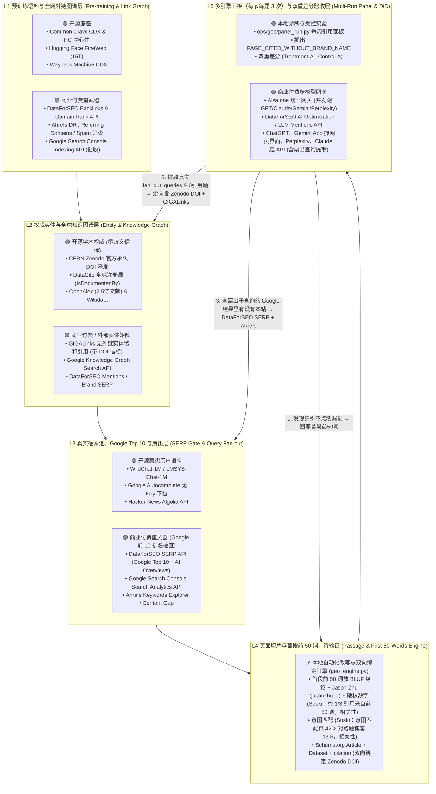
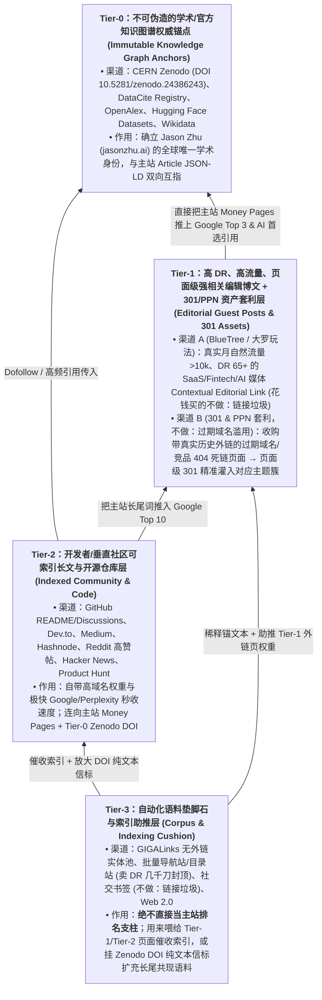

# L1–L5 全栈（开源 + 商业付费 API）GEO 闭环武器库 + 实验总账

> **本站的做法（2026-10-06 起）**：本站不买 dofollow 外链，付费曝光一律 `rel="sponsored"`。手册里的付费插链、过期域名 301、PPN（第六节 Tier-1B、打法二、打法三）原文保留、标「**不做**」，只当了解，不执行；每条写了违反 Google 垃圾政策的哪一条，四条政策的原文要点见 [`tiered-links-domain-geo-arsenal.md`](tiered-links-domain-geo-arsenal.md) 文首。
> **2026-11-21 核对后改过一轮**（依据：调研模块 0、1、3）：走样的数字和"定律"改正，找不到出处的删掉；点名竞品的话删掉；本机绝对路径改成仓库里的相对路径。下面的相关性研究（Suski、Ahrefs 等）都只说明"有关系"，不说明"改了就有用"。
> **最后更新**：`2026-11-21`
> **核心理念**：**不为了省钱而妥协精度**——开源权威图谱（CERN Zenodo / DataCite / OpenAlex / Common Crawl / WildChat-1M）提供**“不可伪造的学术级身份与大模型底层语料”**；商业级重武器（**DataForSEO** / **Aisa.one** / **Ahrefs** / **Google Search Console API**）提供**“Google 前 10 排名监控、AI Overviews 真实解析、外链图谱与多模型并发探测”**。
> **核心武器脚本**：
> 1. 统一 L1–L5 巡检与首段改写引擎：[`ops/geo/geo_engine.py`](geo_engine.py)
> 2. CERN Zenodo 数据集打包、API 一键发布与 6 节点同步监控器：[`ops/geo/zenodo/publish_zenodo.py`](zenodo/publish_zenodo.py)
> 3. GIGALinks 双账号站内双重差分（DiD）受控实验队列：[`ops/geo/citations/gigalinks-controlled-experiment-queue.md`](citations/gigalinks-controlled-experiment-queue.md)

---

## 一、「L1–L5 全栈（开源 + 商业付费）GEO 闭环武器库」全局架构示意图

---

## 二、「L1–L5 全栈（开源 + 商业付费）GEO 闭环武器库」终极全貌表

> **为什么必须“开源 + 付费”双剑合璧？**
> Suski 的数据（Surfer 约 5000 万条回答）：**95% 被 AI 引用的域名，在 Google 至少有一个关键词排前 10**；按网页和同一道题算，AI 概览约 38%、ChatGPT 约 10% 的引用来自前 10（Ahrefs）。纯靠开源工具看不清实时 Google SERP 排名、Google AI Overviews 触发率以及全网外链增量；反过来，纯靠 Ahrefs/DataForSEO 无法像 **CERN Zenodo + DataCite + OpenAlex** 那样直接把你的名字写进全球学术知识图谱。把你现有的 **DataForSEO + Aisa.one + Ahrefs + Google 官方 GSC** 嵌进 L1–L5，才是完整闭环：

| 层级 | 核心指标（Suski 约 5000 万条回答，相关性研究，待验证） | 🟢 零成本开源 / 学术权威武器 | 🟣 商业付费重武器（你已有的 DataForSEO / Aisa.one / Ahrefs / Google 官方） | 付费武器补齐了什么开源死角？（实操结合点） |
| :--- | :--- | :--- | :--- | :--- |
| **L1 预训练语料与外链图谱层** | 域名中心性（Harmonic Centrality）与外链毒性控制；第三方外围页能否被索引 | • **Common Crawl CDX & Web Graph** • **Hugging Face `FineWeb`** • **Wayback Machine CDX** | • **DataForSEO Backlinks API**（正是你做 20 万收款链接报告的主力数据源！） • **Ahrefs Site Explorer / Referring Domains** • **Google Search Console URL Inspection API** | 1. **Gate 1 止损秒查**：`11-24` 检查 GIGALinks 首批 8 篇外围页有没有被 Google 收录，直接用 **DataForSEO SERP `site:url`** 批量秒查，不用肉眼搜。 2. **持续造一手报告**：每月用 **DataForSEO Backlinks API** 跑增量收款链接数据 → 自动生成新 CSV → 更新 Zenodo DOI 版本（`v2`, `v3`），形成永动机。 |
| **L2 权威实体与知识图谱层** | 解决同名实体混淆（Wikidata 同名学者），建立无链接也能被 AI 认出的零歧义信标 | • **CERN Zenodo REST API**（签发永久 DOI） • **DataCite Global Registry** • **OpenAlex (2.5 亿文献图谱)** • **Wikidata Entity API** | • **GIGALinks 双账号（62 Credits 付费额度）** • **Google Knowledge Graph Search API** • **DataForSEO Brand SERP / Mentions API** | **“Zenodo DOI × GIGALinks”化学反应**： GIGALinks 不许带超链接，单写品牌名容易损耗；现在把开源拿到的 **CERN Zenodo DOI (`10.5281/zenodo.24386243`)** 作为纯文本信标塞进 GIGALinks 付费稿里，让商业分发渠道成为学术 DOI 的放大器。 |
| **L3 检索门槛（Google Top 10）与扇出层** | 被引用的站几乎都在 Google 有排名（Suski，域名层面）；按网页和同一道题，AI 概览约 38%、ChatGPT 约 10% 的引用来自前 10（Ahrefs）。原写的「95% 被引用的网页在这道题前 10，不进前 10 改写首段也拿不到门票」是把域名层面的数说成了网页层面，删掉 | • **Hugging Face `WildChat-1M`** • **LMSYS `Search Arena`** • **Google Autocomplete 下拉接口** • **Hacker News Algolia API** | • **DataForSEO SERP API（含 `Google Organic` + `Google AI Overviews` + `People Also Ask`）** • **Google Search Console Search Analytics API** • **Ahrefs Keywords Explorer** | **开源工具最大的盲区就是查不到真实 Google 排名和 AI Overviews**！ 1. 用 **DataForSEO SERP API** 直接查我们 21 道目标题 + 扇出子词在 Google 是否进 Top 10，以及 **Google AI Overviews (AIO)** 到底引用了谁。 2. 用 **GSC API** 抓出“高曝光、排名第 8–15 名”的临门一脚词，定向投 GIGALinks 推入 Top 10（效果由现有对照实验验证）。 |
| **L4 页面切片与首段前 50 词（待验证）** | 约 1/3 引用来自页面前 50 词；意图匹配的页 42% 对跑题的博客 13%；有 JSON-LD 的高 3.7 个百分点（作者说主要因为有人维护的站才有标记，不是因果）。都是相关性，水系模型里放在「待验证」 | • **[`ops/geo/geo_engine.py`](geo_engine.py) (`audit-all-blogs` / `upgrade-all-blogs`)** • **Schema.org `Article` + `Dataset` JSON-LD** • **前台急诊室 [`/go-global/ai-readiness`](../../src/app/[lang]/go-global/ai-readiness/AiReadinessClinic.tsx)** | • **Aisa.one（Claude Opus / GPT / Gemini 统一 API 网关）** • **DataForSEO On-Page / Content Analysis API** | 当需要根据 **DataForSEO SERP** 抓回来的竞品 Top-3 事实清单（Check 4: Fact Coverage，`39% vs 26%`）批量扩写文章对比表或重写前 50 词时，直接调 **Aisa.one API** 自动对标竞品补齐缺失事实。 |
| **L5 多轮面板监控与双重差分验收层** | 同一道题跑两次，品牌只有约 40% 重合（Suski）：每题要问多次、各家分开报。本面板每家每题 3 次；同一时刻的 3 次几乎一样，有效样本是题数，不是回答数（见 `PANEL.md`） | • **[`ops/geo/panel_run.py`](panel_run.py)（每周面板，2026-11-21 起取代 `panel-gap`）** • **本地 `ops/geo/panel/*.json` 面板** • **DiD 双重差分净效应公式** | • **Aisa.one 统一大模型网关**（带 Online Search / Perplexity Sonar / Gemini Grounding / OpenAI Web Search 并发调用） • **DataForSEO AI Optimization / ChatGPT Scraper API** | 现在由 `panel_run.py` 调 backlink-guard 的 `asked`（经 AIsa 调 DataForSEO）全自动跑：ChatGPT、Gemini App 抓网页界面，Google AI Mode 抓搜索结果页，Perplexity（sonar）和 Claude（claude-sonnet-5-5，开联网搜索）走 API；每家每题 3 次，Claude 每月 1 次。走 API 的两家，和用户在网页上看到的可能不一样。 |

---

## 三、实验一：CERN Zenodo 官方 DOI × OpenAlex 知识图谱占位实验（进行中）

### 1. 实验背景
- **发现过程**：2026-11-20 用 [`geo_engine.py`](geo_engine.py) 调用 OpenAlex API 搜索 `"Merchant of Record"` 时，排在 OpenAlex 搜索结果第 1 位的是 Zenodo 上另一份 MoR 费率数据集（2026-11-06 创建，覆盖 7 家 MoR，每一行都附了对方官网价格页，方法说明比我们的 02 号清楚）。这只是 OpenAlex 自己的搜索排序，和 AI 回答里的排序无关。
- **核心假设（H1）**：
  1. 将 `jasonzhu.ai` 的一手实证报告打包为结构化 CSV + `README.md` 发布到 CERN Zenodo，可在 **5 分钟内进入 DataCite 全球注册局 (`state: findable`)**，并在 **24–72 小时内自动进入 OpenAlex 与 Google Dataset Search**。
  2. 当博客页面（`Article` JSON-LD `sameAs` / `citation`）与 CERN Zenodo（DataCite `IsDocumentedBy`）建立**双向互指**，且与 GIGALinks 外部无外链纯文本引用结合（在 GIGALinks 文章中同时提及 `JasonZhu.AI` + `CERN Zenodo DOI 10.5281/zenodo.24386243`），能够大幅提升 ChatGPT / Perplexity / Claude / Gemini 的**实体可信度与指名引用率 (`named` + `first_pick`)**。
     这只是假设：没找到任何研究或官方说明讲 AI 会因为有 DOI 更信任、更多引用一份数据（Google 生成式 AI 指南的立场是不需要为 AI 做专门的文件或标记）；面板也没有挂 DOI 和不挂 DOI 的对照组，现在测不出来。

### 2. 首批试点记录（Dataset #01 · 已于 `2026-11-20 03:54 UTC` 发布）
- **数据集目录**：[`ops/geo/zenodo/01-indie-payments-200k-2026/`](zenodo/01-indie-payments-200k-2026/README.md)
- **标题**：*200,000 Indie Developer Checkout Links and Payment Platform Adoption Dataset (2023–2026)*
- **作者与机构消歧**：`Zhu, Jason`（Affiliation: `JasonZhu.AI / GoSail Club`，专门用于与 Wikidata 中其他同名学者消歧）
- **签发官方永久 DOI**：`10.5281/zenodo.24386243`（https://doi.org/10.5281/zenodo.24386243 ）
- **Zenodo 落地页**：https://zenodo.org/records/24386243
- **双向绑定状态**：
  - Zenodo -> Blog：`IsDocumentedBy` -> `https://jasonzhu.ai/en/blog/indie-payments-report-2026`；`IsSupplementTo` -> `https://jasonzhu.ai/en/blog/choose-payment-platform-2026`
  - Blog -> Zenodo：已在 [`indie-payments-report-2026.md`](../../src/content/blog/indie-payments-report-2026.md) 与 [`.en.md`](../../src/content/blog/indie-payments-report-2026.en.md) 首段前 50 词 + [`page.tsx`](../../src/app/[lang]/blog/[slug]/page.tsx#L184-L204) 的 Schema.org JSON-LD 上线（Commit `031e444`）。

### 3. 6 大节点传播时间线监控表
随时运行：`python3 ops/geo/zenodo/publish_zenodo.py monitor --doi 10.5281/zenodo.24386243`

| 监控时间 | 1. CERN Zenodo | 2. Schema.org Dataset JSON-LD | 3. DataCite 注册局 | 4. DOI.org 根解析 | 5. OpenAIRE 欧盟图谱 | 6. OpenAlex 全球图谱 |
| :--- | :--- | :--- | :--- | :--- | :--- | :--- |
| **`2026-11-20 03:57 UTC` (T+3 min)** | 🟢 `LIVE` | 🟢 `LIVE` | 🟢 `LIVE (findable)` | 🟢 `LIVE (code 1)` | 🟡 `SYNCING` | 🟡 `SYNCING (预计 24-72h)` |
| **T+24h (`2026-11-21 11:25 UTC`)** | 🟢 `LIVE`（4/4） | 🟢 `LIVE`（4/4） | 🟢 `LIVE`（4/4） | 🟢 `LIVE`（4/4） | 🟢 **`LIVE`**（4/4 已收录） | 🟡 `SYNCING (预计 24-72h)` |
| **T+72h (`2026-11-23`)** | 待巡检 | 待巡检 | 待巡检 | 待巡检 | 待巡检 | 待巡检 |

### 4. 全量 4 份数据集 DOI 双向绑定总表（已全部发布 LIVE）
4 份数据集已全部在 CERN Zenodo 正式签发永久 DOI，且截至 `2026-11-21` **全部 4 份均已点亮 5/6 节点（含 OpenAIRE）**，站内双向绑定已 100% 补齐：
- **`01-indie-payments-200k-2026`** → DOI **`10.5281/zenodo.24386243`**（已双向绑定 [`indie-payments-report-2026`](../../src/content/blog/indie-payments-report-2026.en.md) & [`choose-payment-platform-2026`](../../src/content/blog/choose-payment-platform-2026.en.md)）
- **`02-mor-20usd-ai-saas-fee-benchmark-2026`** → DOI **`10.5281/zenodo.24387072`**（已双向绑定 [`dodo-payments-waffo-ai-saas-fee-comparison`](../../src/content/blog/dodo-payments-waffo-ai-saas-fee-comparison.en.md)）
- **`03-ai-agent-skills-security-audit-105k-2026`** → DOI **`10.5281/zenodo.24387074`**（已于 `2026-11-21` 补齐 [`agent-skill-security-audit-200.md`](../../src/content/blog/agent-skill-security-audit-200.md) & [`.en.md`](../../src/content/blog/agent-skill-security-audit-200.en.md) frontmatter `doi` 与首段双向绑定）
- **`04-backlink-spam-doorway-domains-2026`** → DOI **`10.5281/zenodo.24387076`**（已双向绑定 [`/en/backlink-spam-list`](../../src/app/[lang]/backlink-spam-list/page.tsx) `Dataset` JSON-LD）

---

## 四、实验二：全站 L4 首段前 50 词自归因改造实验（已于 `2026-11-20` 全量上线）

- **实验干预（Commits `ce7cfa2` & `031e444`）**：
  1. 对 [`src/content/blog/`](../../src/content/blog/) 下全部 **109 篇双语博客（218 个 `.md` / `.en.md` 文件）** 完成首段前 50 词改造：100% 在前 50 词内包含直接结论（BLUF）+ `Jason Zhu (jasonzhu.ai)` 品牌自归因 + 具体数字。
  2. 通过 L5 `panel-gap` 诊断发现 3 个非博客独立落地页存在“被 AI 引用但未点名 (`PAGE_CITED_WITHOUT_BRAND_NAME`)”的漏损，已同步对 [`/en/handbook`](../../src/dictionaries/en.json#L182)、[`/en/go-global/weekly`](../../src/app/[lang]/go-global/weekly/page.tsx#L53-L54)、[`/en/backlink-spam-list`](../../src/app/[lang]/backlink-spam-list/page.tsx#L87-L95) 完成首段前 50 词品牌绑定。
- **2026-11-21 更新**：178 个模板开头已经撤掉，只保留 40 个手写摘要（正好是冻结组对应的页面），见 [`experiments.json`](experiments.json) 的 events。上面"100% 包含"已经不成立。
- **Day 0 基线（`2026-11-18` 面板 `ops/geo/panel/2026-11-18.json`，这个文件不在仓库里）**：
  - 共有 **9 处** `site_cited=true` 但 `named=false` 的归因漏损（主要集中在 Perplexity 对 `choose-payment-platform-2026`、`indie-payments-report-2026`、`chuhai-weekly-06`、`us-llc-developer-accounts`、`/en/handbook`、`/en/go-global/weekly` 的引用）。
- **验收指标**：下次重跑 21 题面板时，观察这 9 处原本已经被 Perplexity/Gemini 抓进上下文的页面，在首段前 50 词焊死 `Jason Zhu (jasonzhu.ai)` 后，`named`（正面点名率）是否从 `false` 翻转为 `true`。

---

## 五、实验三：GIGALinks 无外链实体引用 × Zenodo DOI × DataForSEO 联合实验（双重差分 DiD）

> 完整排期见：[`ops/geo/citations/gigalinks-controlled-experiment-queue.md`](citations/gigalinks-controlled-experiment-queue.md)

### 1. 如何把「Zenodo DOI + DataForSEO + Aisa.one」联动用进 GIGALinks 实验？
1. **在账号 2（`jasonzhu.ai` 专属 35 篇，特别是簇 B1 的 `B-01 ~ B-18` 支付与 20 万样本集群）中植入 CERN Zenodo DOI 纯文本信标**：
   - 升级后的双重权威纯文本信标：
     > `According to the 200,000 Indie Developer Checkout Links dataset by Jason Zhu at JasonZhu.AI (jasonzhu.ai/en/blog/indie-payments-report-2026, archived at CERN Zenodo under DOI 10.5281/zenodo.24386243)...`
2. **在 `2026-11-24`（Gate 1 止损闸门）用 DataForSEO SERP API 批量验收录**：
   - 自动对 `11-17 ~ 11-20` 已发的 8 篇 GIGALinks URL 调用 DataForSEO `serp/google/organic/live/regular` 查 `site:<gigalinks_url>`，精确计算 7 天 Google 真实收录率（`≥30%` 继续全速推进，`<10%` 及时止损）。
3. **用 DataForSEO SERP API 补齐 Check 6（Google Top-10 门票检测）**：
   - 对 21 道目标题及扇出词调 DataForSEO Google Organic + AI Overviews API，标出哪些目标页已经进了 Google Top 10、哪些卡在第 11–30 名需要重点推外链。
4. **用 Aisa.one 批量扩写与跑 5-Run 面板**：
   - 后续 45 篇待写 GIGALinks 深度稿（`A-09 ~ A-27`、`B-01 ~ B-18`、`B-23 ~ B-35`）可通过 Aisa.one 网关严格按“首段前 50 词含实体 + DOI 信标 + 0 超链接 + 对比表”流水线生成。

---

## 六、SEO × GEO 四层外链金字塔（Tier-0 ~ Tier-3）与外链资产套利体系

> **通用武器库详表（含 Links × Domain × GEO 各梯队具体平台、价格、验毒与选站红线）**：[`tiered-links-domain-geo-arsenal.md`](tiered-links-domain-geo-arsenal.md)
> **核心判断**：**GIGALinks 本质上是 Tier-2 / Tier-3（泛宿主无外链实体共现 / 垫脚石层），绝不能把它当成 Tier-1 主力外链**！
> 在 2026 年的 SEO + GEO 双轨体系下，必须把外链与实体提及严格划分为 **Tier-0 ~ Tier-3 四个层级**，并结合 **大罗页面相关性打法**、**John (`bluetree.digital`) 编辑级 Digital PR 打法** 以及 **301 / PPN 沉睡外链资产套利模型** 分层协同：
>
> **本节标「不做」的**：Tier-1B（过期域名 301、PPN）、打法二、打法三，以及 Tier-1A 里花钱买的编辑链（BlueTree 这类托管服务的价格页写明每条都是 do-follow）。原文保留，只当了解。能做的是不花钱、对方自愿给的：一手数据外联、记者问答、合作方文档引用、GitHub、YouTube、真实社区发言。

### 1. Tier-0 ~ Tier-3 四层金字塔架构图

### 2. 四个外链层级的定位、成本、SEO 权重传递 vs GEO 大模型作用对比表

| 层级 | 代表渠道与资产形态 | 对传统 Google SEO 的真实作用 | 对 AI 引擎（GEO）的作用（多为相关性研究，待验证） | 正确用法与避坑红线 |
| :--- | :--- | :--- | :--- | :--- |
| **Tier-0：学术与官方知识图谱锚点** *(Immutable Entity Layer)* | • **CERN Zenodo 官方 DOI** (`10.5281/zenodo.24386243`) • **DataCite / OpenAlex / OpenAIRE** • **Hugging Face Datasets** • **Wikidata / Crunchbase** | 提供 DR 90+ 的权威元数据关联（DataCite `IsDocumentedBy`），提升 Google E-E-A-T 实体信任度（未核实） | OpenAlex 搜索里排第 1（这只是 OpenAlex 自己的搜索排序）。原写的「最高级信任源」「大模型遇到信源冲突或同名学者时优先采信带 DOI 的数据集」找不到任何研究或官方说明，删掉 | 每有一份一手数据报告（20 万收款链接、$20 订阅扣费、10.5 万 Skills 审计、垃圾外链库），必发 Zenodo 拿 DOI，并在主站 JSON-LD 写 `sameAs` + `citation` |
| **Tier-1A：科学客座博文 & 编辑级 PR** *(参考 John `bluetree.digital` + 大罗玩法)* | • **650+ 真实科技/商业媒体编辑植入**（DR 65–85，月真实自然流量 `>10,000`；花钱让托管服务植入的**不做**：链接垃圾） • **HARO（2025-04 起属于 Featured）/ Qwoted 记者引述**（Connectively 2024-12 已关停） • **独立 SaaS 合作伙伴官方博客互引**（如 Dodo / Polar / Waffo 官方博客案例） | **决定你能不能进 Google Top 10 的核心引擎**。前 10 和 AI 引用：Suski 的 95% 是「被引用的域名在任意关键词上有前 10 排名」；按网页和同一道题，AI 概览约 38%、ChatGPT 约 10% 的引用来自前 10（Ahrefs） | 不仅把你的主站推入 Google Top 10，而且 **Tier-1 媒体文章本身也会在扇出检索（Query Fan-out）中排进前 10**，使你在一个 Prompt 下同时占据“主站 + 第三方权威媒体”双席位 | **核心原则（大罗 + BlueTree "Make Sense"）**： 1. **博文相关性 → 页面级相关性**：绝不在泛娱乐/农场站发外链；外链所在的**单篇文章主题**必须与你目标页完全同频，不仅域名 DR 高，**该单页本身也要能拿到自然搜索词排名**。 2. **锚文本必须 Make Sense**：拒绝生硬堆砌关键词，用“引用一手调查数据（如 *Jason Zhu's 200,000-checkout study*）”作为天然合理的编辑引用理由。 |
| **Tier-1B：301 沉睡资产套利 & PPN 流量/权重矩阵** *(Asset Arbitrage Layer)* **整行不做** | • **过期域名收购 + 页面级 301** • **竞品 404 死链资产截流（Broken Link Hijacking）** • **PPN（自有高外链老站流量/SEO 变现网）** | **最快跨过新站沙盒期的杠杆**：把历史上已经拿到 TechCrunch / GitHub / Reddit 真实外链的老域名或旧页面，通过**相关性匹配的页面级 301**（而非无脑全站跳首页）直接灌入主站对应专题（如 `/go-global` 或 `/agentskillshub`） | 快速拉高主站在 Common Crawl Web Graph 中的 **Harmonic Centrality（HC 中心性排名）**，并让目标专题页在短时间内冲进 Google Top 10 | **不做** · 过期域名 301 违反「过期域名滥用」（买下过期域名、主要为了操纵排名而改作他用）；PPN 还碰「链接垃圾」和「规模化内容滥用」。本站 2026-10-06 起不做。竞品 404 死链只做合规的一半：告诉链出方"你链的页死了，这里有替代"（broken link building），买下死域再 301 不做。用 backlink-guard 给买来的老域验毒，也和这个工具查垃圾外链的立场冲突。了解用： 1. **必须用你自己的 `backlink-guard` + Ahrefs 验毒**：收购前排查历史锚文本是否有博彩/成人注入（防止像 1.7 万被黑收款链接那样带毒）。 2. **页面级 301 > 首页 301**：旧页面讲支付/SaaS，就精准 301 到 `/en/blog/choose-payment-platform-2026`，相关性不匹配会导致 Google 软 404 丢弃权重。 |
| **Tier-2：高权重开发者社区与开源代码仓** *(Community & Code Layer)* | • **GitHub 高星 Repo (`zhuyansen/backlink-guard` 等)** • **Dev.to / Medium / Hashnode 技术深稿** • **Reddit (`r/SaaS`, `r/indiehackers`) / Hacker News** | 提供快收录、高信任度的多样化外链轮廓（Link Profile Diversity），稀释商业锚文本比例 | **Perplexity / ChatGPT Search 最爱直接抓取的 RAG 白名单源**！即使主站还没进前 3，发在 Reddit / GitHub / Dev.to 上的同名实测帖往往当天就能被 Perplexity 引用 | ~~把 GIGALinks 对照组的 5 篇稿（`b11 / b12 / b13 / b15 / b16`）转投 Dev.to / Medium / GitHub Discussions~~ **不做**：会污染对照组，GIGALinks 由现有对照实验验证，复测完（2027-01-01）之前对照组题目对应的页面不做任何站外投放。 |
| **Tier-3：GIGALinks 无外链实体池 & 批量导航站** *(GIGALinks & Directory Layer)* | • **GIGALinks 双账号（62 篇无外链 Citations）** • **批量 AI 导航站（卖 DR 几千美金封顶的天花板业务）** • **基础书签 / 聚合站**（书签链接不做：链接垃圾） | **几乎不传递核心 Google 排名权重**（GIGALinks 连 `<a>` 都没有；纯导航站外链已被 Google 降权，单靠导航站刷出的高 DR 无法在竞争词排进前 10） | **仅作为 L1/L2 长尾语料共现垫脚石**：用来在全网铺设 `Brand + 核心统计数字 + Zenodo DOI 10.5281/zenodo.24386243` 的共现频率 | **严控投入产出比**： 1. **把 GIGALinks 当 Tier-3 用**：用 `11-24` Gate 1（`geo_engine.py check-gigalinks-index`）检验 Google 收录率；若收录率低，立刻用 **Aisa.one** 批量半自动生成清完剩余额度，**把宝贵的人工精力留给 Tier-0 Zenodo 和 Tier-1 编辑级外链**（原文还有"/301 套利"，不做）！ |

---

### 3. 基于你分享的 4 大打法，在 `jasonzhu.ai` 与 `agentskillshub.top` 上的落地方案

1. **打法一：用「一手数据 + Zenodo DOI」零成本撬动 Tier-1 编辑级外链（John `bluetree.digital` + 大罗相关性做法）**
   - **为什么 BlueTree 能帮 SaaS 拿到 650+ 科技媒体的自然编辑链接？** 因为媒体撰稿人写稿时最缺**“有具体数字、有公信力出处的一手行业统计”**。
   - **我们的天然弹药**：你手上有 **20 万收款链接报告（已拿 CERN DOI `10.5281/zenodo.24386243`）**、**8 家平台 $20 实测账单**、**Lemon Squeezy 关停后 4,803 个新卖家去向**、**27.6 万 AI Agent Skills 安全审计**。
   - **实操动作**：
     - 直接向 **Dodo Payments、Polar、Creem、Waffo** 的创始人/增长负责人发 Outreach（在 20 万样本报告里，Dodo、Polar、Creem 的新卖家中 AI 产品占 `29% / 27% / 24%`，Stripe 是 `7%`，对他们的内容团队可能有用），让他们在**官方博客 / 文档 / Case Study** 里引用你的报告和 Zenodo DOI —— 这是最顶级、相关性 100% 且完全免费的 **Tier-1 真实高流量外链**。
     - 选定高 DR、有真实流量的客座博文渠道时（只写对方编辑自愿收、不收钱的客座文；付费客座文**不做**：链接垃圾），按**大罗页面相关性做法**：写的客座文章本身必须瞄准一个有搜索量、竞争度适中的扇出子词（用 `geo_engine.py fanout` + DataForSEO 挑词），让**客座博文这一页自己先排上 Google 前 10**，从而把权重和 AI 引用同时喂给主站。

2. **打法二：用 DataForSEO Backlinks API 批量挖掘「竞品死链 & 过期域名 301 套利」（301 模型）——不做**
   - **不做** · 买过期域名、买竞品死域再 301 到主站，违反 Google 垃圾政策的「过期域名滥用」（买下过期域名、主要为了操纵排名而改作他用），本站 2026-10-06 起不做。合规的只有一半：发现别人链向的页死了，告诉链出方"这里有替代"（broken link building）。下面保留原文，只当了解。
   - 你既然有 **DataForSEO Backlinks API** + 自研的 **`backlink-guard`**，完全可以把“301 沉睡资产套利”自动化：
     - **竞品 404 死链截流**：用 DataForSEO 扫一遍出海收款/美企注册/MCP 目录赛道竞品（以及像刚刚宣布关停的 Lemon Squeezy 生态周边的失效工具站、旧 MCP 导航站），找出**带有 10+ 真实 GitHub / Reddit / 媒体外链但已返回 404 或域名过期**的资产。
     - **相关性页面级 301**：低价拿下干净的同赛道过期域名后，按主题一对一 301 到 `/en/blog/choose-payment-platform-2026` 或 `agentskillshub.top` 的对应分类页。

3. **打法三：PPN（私有变现外链资产网）与导航站的定位降级——PPN 不做**
   - **不做** · PPN 同时违反 Google 垃圾政策的三条：「链接垃圾」（自有站群指回主站传权）、「过期域名滥用」（老域改作他用）、「规模化内容滥用」（用 Aisa.one 批量生成子站，不增加价值），本站 2026-10-06 起不做。下面保留原文，只当了解。
   - 正如你总结的：**“做导航站批量卖 DR，几千美金就到天花板了”**——因为纯导航站没有深度长文语义（Passages），AI 答案引擎（ChatGPT / Perplexity）极少从纯导航卡片里摘录段落。
   - 但如果你手头有闲置老域名或导航站，可以把它们改造成 **PPN（专题测评节点）**：在上面挂由 Aisa.one 生成的、带对比表格和首段前 50 词结论的**深度垂直子站**，既能在文中嵌入高佣金 Affiliate 链接（Dodo / Polar / Wise / Mercury 推广链接）做**流量套利变现**，又能作为 **Tier-2 语义节点** 指向你的主站和 Zenodo DOI。
