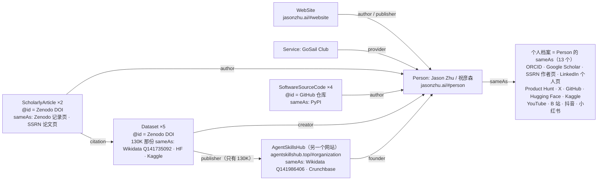

# 实体信息统一与学术存档 SOP

> **Author / Owner:** Jason Zhu (Yansen Zhu · 祝彦森) · ORCID [`0009-0000-2894-6285`](https://orcid.org/0009-0000-2894-6285)  
> **Canonical Entity Homes:** [`jasonzhu.ai/en`](https://jasonzhu.ai/en) · [`agentskillshub.top`](https://agentskillshub.top)  
> **Version:** v2.3（2026-11-22 北京时间，修改轮 2）。这一版改了文件名（`git log --follow` 能看到之前的历史）。v2.1 以来的每次改动记在 [`ENTITY-GRAPH-ITERATION-LOG.md`](ENTITY-GRAPH-ITERATION-LOG.md)（发现、修复、谁做、复查日期）  
> **Scope:** 让本人、作品和网站在搜索引擎、AI 和学术索引（Google、Bing、OpenAlex、Semantic Scholar、Google Scholar）里的信息一致：哪些网址代表本人，哪些是作品，怎么存档到 Zenodo 和 SSRN，怎么核对。

> [!warning] 现在的状态（2026-11-21）
> - **数据纠正完之前（修改轮 2 的代理 Z 在做：Zenodo 新版本、工作论文改版），不再往 ORCID、Google Scholar、SSRN、OpenAlex、Wikidata 这些学术图谱里绑新东西。** 迭代记录「当前待办」里的 ORCID 任职、Wikidata 两批、OpenAlex 认领、学术外联三封，都先停。
> - Wikidata 个人条目**暂缓**，理由见第 6 节 Phase 3。
> - 个人站，不写公司：本站 JSON-LD 没有 Organization 节点，网站的发布者是本人。规则见第 4 节「实体规则」。

---

## 1. Core Mechanism: How Major Knowledge Graphs Decide Whom to Trust

Search engines and AI answer engines do **not** trust self-proclaimed JSON-LD on an isolated domain. Every major knowledge graph executes a 5-stage ingestion pipeline:

```text
1. Discovery            -> Crawlers find an entity + original facts on an Entity Home
2. Entity Resolution    -> Deduplicate same-name collisions via immutable global primary keys (ORCID, DOI, QID)
3. Relation Extraction  -> Parse typed triples (AgentSkillsHub -founder-> Person; ScholarlyArticle -author-> Person; Dataset -creator-> Person)
4. Multi-Source Loop    -> Verify bidirectional corroboration (A -> B AND B -> A) across 6+ independent high-DR graphs
5. Citation Weighting   -> Rank entity authority by third-party inbound citations, academic indexes, and temporal freshness
```

**Cardinal Rule:** Without **original empirical facts** (first-hand census datasets, itemized fee benchmarks, security audits), external graphs will not mint durable authority around your entity. Data is the payload; persistent identifiers and bidirectional links are the delivery vehicle.

> 上面五步和这条规则是我们的工作假设，没有哪家搜索引擎公开过这样的流程（未核实）。

---

## 2. 本站 JSON-LD 里的实体关系（v2.3，2026-11-21 修复后）

全站每一页只有四个节点：Person（本人）、WebSite、Service（GoSail Club）、AgentSkillsHub。没有 Organization 节点。论文、数据集、开源工具只出现在 /research、引用它的博客文章页和 /backlink-spam-list。数据都在 `src/lib/profiles.ts`。



---

## 3. Baseline (v1) vs. Executed Upgrades (v2) Ledger

### What v1 Already Had (Baseline)
- 4 original empirical datasets (200k indie checkout links, \$20 MoR subscription fees, 105K/130K AI agent skills security audit, 581 backlink-spam doorway domains).
  - 更正（调研模块 0 第 A 节，2026-11-21）：Zenodo 上 01、03、04 号都是 3–9 行的汇总表；01 号不含任何链接，04 号一个域名都没有。数据纠正在做。
- Dual Entity Homes (`jasonzhu.ai`, `agentskillshub.top`) with initial JSON-LD and `/llms.txt`.
- Scattered external nodes: 5 Zenodo CSV records (no ORCID, no PDF), Wikidata `Q141986406` & `Q141735092`, GitHub, PyPI `backlink-guard`, npm `@agentskillshub/*`, Crunchbase, dev.to.

### Critical KG Defects Fixed in v2 (2026-11-21)

| Layer | v1 Defect | v2 Fix Shipped & Verified | Live Anchor / Evidence |
| :--- | :--- | :--- | :--- |
| **1. Primary Key & Disambiguation** | `Jason Zhu` collided with medical/chemistry scholars & `Jason (Siyu) Zhu`; CN `祝彦森` and EN `Jason Zhu` were split. | Minted **ORCID** (`0009-0000-2894-6285`), verified **Google Scholar** (`AlP5JacAAAAJ`) with the author's own email, unifying 2019 CN papers + 2026 EN research with zero medical misattribution, and OAuth-bound **SSRN** (`14044888`). | [ORCID](https://orcid.org/0009-0000-2894-6285) · [Scholar](https://scholar.google.com/citations?user=AlP5JacAAAAJ) · [SSRN](https://papers.ssrn.com/sol3/cf_dev/AbsByAuth.cfm?per_id=14044888) |
| **2. Typed Triples & Schema Hygiene** | `/en` JSON-LD leaked Chinese copy; Person/Org/Product/Dataset collapsed into one `sameAs`; dead Wikidata QID present. | 中文外泄、失效 QID 已修。**sameAs 混用当时没修好**：2026-11-21 线上实测，Person 的 sameAs 23 条里有 10 条是作品或别的网站（6 个 DOI、2 篇 SSRN 论文页、PyPI、agentskillshub.top），Organization 的 sameAs 用的是同一份列表；`Person -founder-> 公司 -subOrganization-> AgentSkillsHub` 这条边也不对（个人站不写公司）。`f06c11a`（11-22）先把 Person 的 sameAs 收到 13 个个人档案。`08fce2d`（修改轮 2）去掉 Organization 节点；AgentSkillsHub 单独成节点，founder → #person；论文、数据集、工具拆进 `WORKS`，只在 /research、引用它的博客文章页和 /backlink-spam-list 输出；加了 `scripts/check-entities.mjs`。 | `src/lib/profiles.ts` · `src/app/[lang]/layout.tsx` · `scripts/check-entities.mjs` |
| **3. 9-Graph Bidirectional Corroboration** | One-way outbound links from main site only; HF/Kaggle incomplete. | Back-wrote ORCID into **5/5 Zenodo datasets**; completed **3/3 HuggingFace** and **3/3 Kaggle** datasets with ORCID+DOI+URL anchors; updated GitHub profile/repo, Product Hunt (`@yansen_zhu`), LinkedIn, and PyPI `pyproject.toml`.（更正：11-21 实测 24386243 没挂 ORCID，11-22 用 `zenodo/fix_creators.py` 补上。各个人档案有没有链回本站，见第 5 节「回链核对」。） | [HF](https://huggingface.co/jasonzhuyansen) · [Kaggle](https://www.kaggle.com/yansenzhu) · [PH](https://www.producthunt.com/@yansen_zhu) · [GitHub](https://github.com/zhuyansen) |
| **4. Scholarly PDF Crawler Ingestion** | Bare CSVs on Zenodo are skipped by Google Scholar / OpenAlex paper crawlers. | Typeset 2 formal Typst academic Working Paper PDFs (10p + 7p), published to **Zenodo (`workingpaper`)** + **SSRN (CC BY)** + hosted at **`jasonzhu.ai/en/research/[slug]`** with Highwire Press `citation_*` meta tags & BibTeX.（安全论文的 DOI `10.5281/zenodo.24420920` 到 2026-11-21 还没在 doi.org 登记，打开是 404。） | [Paper 1 Zenodo](https://doi.org/10.5281/zenodo.24420871) · [SSRN #7737182](https://papers.ssrn.com/sol3/papers.cfm?abstract_id=7737182) · [Paper 2 Zenodo](https://doi.org/10.5281/zenodo.24420920) · [SSRN #7737258](https://papers.ssrn.com/sol3/papers.cfm?abstract_id=7737258) |

---

## 4. Repeatable Academic Publishing SOP (Zero-Fee Google Scholar Ingestion)

Whenever a new flagship empirical study is published on `jasonzhu.ai`, run this 25-minute pipeline so it enters academic + AI search indexes automatically:

1. **Typeset Academic Working Paper PDF with Typst (6–10 pages)**
   - Source templates: `ops/geo/papers/Zhu-2026-*.typ`
   - Required sections for Google Scholar / SSRN acceptance: Title (no hyphenation), Author + Affiliation + ORCID, Formal Abstract, Keywords + JEL/ACM Codes, Numbered Sections, Methodology + Equations/Tables, Limitations, Open Data Availability (DOIs + mirrors), Formal References.
   - Compile (run from the repo root): `typst compile --root . ops/geo/papers/<name>.typ ops/geo/papers/<name>.pdf`
   - Copy PDF to `public/papers/<name>.pdf` and add an entry in `src/lib/research.ts` (automatically creates `/[lang]/research/[slug]` with `citation_pdf_url` & `ScholarlyArticle` JSON-LD).
2. **Publish to Zenodo as `publication` / `workingpaper`**
   - Set `creators[].orcid = "0009-0000-2894-6285"`, `license = "cc-by-4.0"`, and `related_identifiers` linking underlying dataset DOIs (`isSupplementedBy`) + canonical blog URL.
   - 博客网址不要用 `isIdenticalTo`：Zenodo 导出的 JSON-LD 会把它写成 `sameAs`，等于说论文就是博客文章（24420871 的导出现在就是这样，已核实）。换别的关系前，先看一眼 Zenodo 的 JSON-LD 导出。
   - Add the minted DOI into ORCID (`working-paper`) via ORCID UI/API.（数据纠正完之前先不加，见文首。）
3. **Submit to SSRN (Elsevier)**
   - Upload PDF (`Preprint`, `CC BY`), verify extracted Title/Abstract/Date/Keywords, choose 3–6 leaf eJournal classifications, fill transparent Declaration of Interest & self-funded Funder Statement, submit and record the permanent `abstract_id`.
4. **Sync Bidirectional Links**
   - 论文加进 `src/lib/profiles.ts` 的 `WORKS`（ScholarlyArticle：@id 用 Zenodo DOI，sameAs 放 Zenodo 记录页和 SSRN 论文页），再加进 `src/lib/research.ts` 和 `zhuyansen/zhuyansen/README.md`。不要放进 `PERSON_PROFILES`。
   - 跑 `node scripts/check-entities.mjs`。

### 实体规则（2026-11-21 起）

- `PERSON_PROFILES`：只放代表本人的档案：ORCID、Google Scholar、SSRN 作者页、LinkedIn 个人页、Product Hunt、X、GitHub 用户页、Hugging Face 用户页、Kaggle 用户页、YouTube、抖音、小红书。全站 Person 的 sameAs 只读它。B 站 2026-11-24 拿掉了：主页名字是「香菇的猪」、简介空，证明不了是本人；改名、写上 jasonzhu.ai 后再加回。
- `WORKS`：论文写 ScholarlyArticle，同一篇论文的 SSRN 页和 Zenodo 页用 sameAs 连在一起；Zenodo 数据集写 Dataset；开源工具写 SoftwareSourceCode（codeRepository 放 GitHub 仓库，PyPI 放 sameAs）。sameAs 只放同一个作品：HF、Kaggle、GitHub 上把 01 和 02 合在一起的那份镜像，两份都不写。
- `RELATED_SITES`：AgentSkillsHub。单独一个节点，founder 指向 #person；sameAs 只放 Wikidata Q141986406 和 Crunchbase；不挂在谁下面。
- 个人站，不写公司：没有 Organization 节点。网站的作者和发布者、GoSail Club 的提供者都是 #person。
- 作品不进全站图，只在 /research、引用它的博客文章页和 /backlink-spam-list 输出，author 或 creator 指向 #person。
- 检查：`node scripts/check-entities.mjs`（线上），`node scripts/check-entities.mjs http://localhost:3000`（本地）。Zenodo 发新版本换 DOI 时，`WORKS`、博客 frontmatter 的 `doi`、`src/lib/research.ts` 三处一起换，脚本会查。

### 维护规则（2026-11-24 起）

依据：2026-11-23 面板里带品牌名的题四家已经引用本站 50–100%，AI 引用最多的 20 个网站里没有一个学术站；差距在不带品牌名的题。详见 `ENTITY-GRAPH-ITERATION-LOG.md` v2.4。

1. **学术图谱只修错，不扩张。** 只修错的事实：作品挂在别人名下、DOI 打不开、数字和源头对不上。不新建 Wikidata 条目，不认领、合并 OpenAlex 作者页，不为进学术索引去找 Semantic Scholar 收录、arXiv 背书。
2. **只用总 DOI（concept DOI）。** 站上、镜像、文案一律写总 DOI，它总指向最新版本。数据小错攒着，每季度一起发一次 Zenodo 新版本：每发一次都要同步站上、三个镜像、dev.to 和已发出去的更正信。
3. **每个检查分三种结果：通过、有问题、测不出来。** 先查一个必中的东西（比如 `site:jasonzhu.ai` 第一条必是本站），查不中就写「测不出来」，不写 0 或「通过」。定时任务最后一步直接看结果文件进没进仓库，不看运行状态。
4. **每轮改动在 `experiments.json` 记一条：** 日期、改了什么、预期动面板哪一项。面板周报会列出最近 5 条。
5. **效果看三样：** 面板里不带品牌名的题有没有引用本站；AI 搜的不带品牌名的词，我们在 Google 前 20 有几条；品牌词（`brand_serp`）本站排第几。都是每周一的面板邮件，看走势，差 10–15 个百分点以上才算数。

---

## 5. Complete Live Asset Inventory (All Persistent Anchors)

### Author & Brand Entity Nodes
- **Entity Home (EN/ZH):** `https://jasonzhu.ai/en` · `https://jasonzhu.ai/en/research`
- **ORCID:** `https://orcid.org/0009-0000-2894-6285`
- **Google Scholar:** `https://scholar.google.com/citations?user=AlP5JacAAAAJ`
- **SSRN Author Page:** `https://papers.ssrn.com/sol3/cf_dev/AbsByAuth.cfm?per_id=14044888`
- **LinkedIn（个人页）:** `https://www.linkedin.com/in/jason-zhu-a52aa73bb/`。公司页 `https://www.linkedin.com/company/gosailglobal/` 不放进本站 JSON-LD（个人站，不写公司）
- **Product Hunt:** `https://www.producthunt.com/@yansen_zhu`
- **GitHub:** `https://github.com/zhuyansen`
- **Hugging Face:** `https://huggingface.co/jasonzhuyansen`
- **Kaggle:** `https://www.kaggle.com/yansenzhu`
- **Wikidata Entities:** AgentSkillsHub (`https://www.wikidata.org/wiki/Q141986406`) · 130K Dataset (`https://www.wikidata.org/wiki/Q141735092`)
- **Crunchbase（AgentSkillsHub 的）:** `https://www.crunchbase.com/organization/agent-skills-hub`
- **PyPI / npm:** `https://pypi.org/project/backlink-guard/` · `@agentskillshub/cli` · `@agentskillshub/mcp`

### Working Papers (PDF) & Open Datasets (All CC-BY-4.0)
| Artifact | Zenodo DOI | SSRN / Mirrors |
| :--- | :--- | :--- |
| **Working Paper #1 (10p PDF):** 200K Indie Payments & \$20 MoR Shift | `10.5281/zenodo.24420871` | SSRN `#7737182` · `jasonzhu.ai/en/research/indie-saas-payments-mor-shift-2026` |
| **Working Paper #2 (7p PDF):** 105K+ AI Agent Skills & MCP Security | `10.5281/zenodo.24420920`（11-21 还没在 doi.org 登记） | SSRN `#7737258` · `jasonzhu.ai/en/research/ai-agent-skills-mcp-supply-chain-security-2026` |
| **Dataset 1:** 收款平台采用情况汇总表（9 行，不含链接） | `10.5281/zenodo.24386243` | GitHub · HF · Kaggle 上的 `indie-saas-payments-benchmark-2026` 把 01 和 02 合在一起，不算同一个数据集，JSON-LD 不写 sameAs |
| **Dataset 2:** \$20 MoR Cross-Border Fee Benchmark | `10.5281/zenodo.24387072` | 同上（合在一起的镜像） |
| **Dataset 3:** AI Agent Skills 安全审计汇总表（3 行） | `10.5281/zenodo.24387074` | 没有镜像。HF、Kaggle 上的 `agent-skills-security-grades` 是 Dataset 5 |
| **Dataset 4:** 垃圾外链名单（Zenodo 现版本只有 3 行"模式"，没有域名；换成真实域名表的新版本在做） | `10.5281/zenodo.24387076` | GitHub `backlink-spam-list` · HF · Kaggle。`backlink-guard` 是另一个作品（软件），不是镜像 |
| **Dataset 5:** 130K AI Agent Skills Security Grades（AgentSkillsHub 发布） | `10.5281/zenodo.21292799` | Wikidata `Q141735092` · HF · Kaggle |

### 回链核对（2026-11-21 查，2026-11-24 定要不要补）

每个个人档案有没有链回 jasonzhu.ai。只用公开、免费的接口和不登录的页面；补回链要本人登录各平台去改。

2026-11-24 定：只补 X（website 字段改成 jasonzhu.ai）和 YouTube（加链接），Google Scholar 设成公开；Hugging Face、Kaggle 不补；B 站已从 sameAs 拿掉。11-24 已做：YouTube、Google Scholar、X 的 website。

| 档案 | 链回本站 | 怎么查的、看到什么 |
| :--- | :--- | :--- |
| ORCID | 有 | 公开 API `researcher-urls`：`https://jasonzhu.ai/en` |
| GitHub | 有 | `gh api users/zhuyansen` 的 blog 字段：`https://jasonzhu.ai`。简介里的「200k Checkout Links & 105k」数据纠正后要改 |
| X | 有（11-24） | `api.fxtwitter.com` 的 website 字段：jasonzhu.ai（原来是 gosaillab.com，简介第一行还留着）；简介正文也写了 jasonzhu.ai |
| Hugging Face | 没有 | 个人页没填网站和任何社交链接（对照：别人的个人页能读到这些链接） |
| Kaggle | 没有 | 公开页显示 "No bio yet"，没有外链 |
| YouTube | 有（11-24） | 频道「链接」加了 JasonZhu.AI → https://jasonzhu.ai，不登录打开频道页能看到 |
| B 站 | 没有 | 公开接口：账号名「香菇的猪」，简介空白，外人看不出是同一个人 |
| 抖音 | 没看到 | 不登录能看到的部分没有 jasonzhu.ai |
| 小红书 | 没看到 | 不登录能看到的部分没有（网址跳到 rednote.com） |
| Google Scholar | 公开（11-24） | 11-24 前对外返回 404；勾上「将我的个人学术档案设为公开」后不登录能打开，个人页的「首页」链到 https://jasonzhu.ai/en |
| SSRN 作者页 | 不确定 | 脚本访问被拦（403 / Content Blocked），要在浏览器里打开确认 |
| LinkedIn | 不确定 | 要登录才能确认 |
| Product Hunt | 不确定 | Cloudflare 拦截脚本，要在浏览器里打开确认 |

---

## 6. v3 Optimization Roadmap (From 90% Static Skeleton to Citation Dominance)

### Phase 1: Final Skeleton Polish (Immediate / Same-Day)
- [x] **SSRN Affiliation:** Added `GoSailGlobal LLC (BRICKAI / JasonZhu.AI)` to SSRN Author `14044888`.
- [x] **`jasonzhu.ai/en/research` + `public/papers/*.pdf`:** Dedicated academic landing pages emitting Google Scholar Highwire Press `citation_*` meta tags, `ScholarlyArticle` JSON-LD, direct PDF downloads, and BibTeX (wired into `sitemap.ts` & `llms.txt`).
- [ ] **Deploy 2 locally updated sibling repos on next normal release:**
  - `agentskillshub.top` (`frontend/index.html` + `frontend/scripts/generate-static-pages.mjs` already updated locally)
  - PyPI `backlink-guard` (`pyproject.toml` already updated locally; bump to `0.12.1` + `twine upload` to refresh PyPI & `deps.dev`)——2026-11-21 查 PyPI 已是 0.12.1

### Phase 2: Build the Third-Party Citation Graph (Weeks 2–4 — Highest GEO ROI)

> **2026-11-21 起暂停。** 数据纠正完之前，不往学术图谱绑新东西（2C），也不发引用这些数字和 DOI 的外联、PR 和帖子（2A、2B、2D）。依据：调研模块 0「先改源头，再发任何东西」。下面的文案等 Zenodo 新版本发布后按新数字重写。
>
> 下面文案里的 DOI 是旧的版本号，用之前换成总 DOI：收款论文 `10.5281/zenodo.24420870`，安全论文 `10.5281/zenodo.24420919`。安全论文的 1.0 版 `24420920` 一直没登记上，不能用。

#### 2A. Upgrade Day+5 Media Outreach (`2026-11-26` follow-up)
Append this 2-line scholarly citation hook to the Day+5 follow-up in `ops/geo/tier1-data-outreach-pack.md`:
> *"Quick update: we also released the full 10-page empirical working paper PDF (CC-BY-4.0) on SSRN (`https://papers.ssrn.com/sol3/papers.cfm?abstract_id=7737182`) and Zenodo (`https://doi.org/10.5281/zenodo.24420871`) in case your editorial team prefers citing a permanent DOI / PDF."*

#### 2B. High-DR GitHub Awesome Lists PRs (Ready-to-Submit Copy)
Submit purely neutral, zero-promo dataset/benchmark entries to 3 high-star curated repos:
1. **`punkpeye/awesome-mcp-servers` / `wong2/awesome-mcp-servers` (Security / Benchmarks section):**
   ```markdown
   - [AI Agent Skills & MCP Security Audit Benchmark (105K–130K)](https://doi.org/10.5281/zenodo.24420920) — Open-source 44-rule static security grading census and 5-dimension supply-chain audit working paper across 130,000+ indexed agent skills and MCP servers ([SSRN #7737258](https://papers.ssrn.com/sol3/papers.cfm?abstract_id=7737258), CC-BY-4.0).
   ```
2. **`hesreallyhim/awesome-claude-code` / `travisvn/awesome-claude-skills` (Security & Auditing section):**
   ```markdown
   - [Agent Skills Hub Security Rubric & 130K Audit Dataset](https://agentskillshub.top/how-we-grade/) — Open 44-rule security grading methodology and working paper analyzing credential custody, shell hooks, and prompt injection across 105K+ open-source Claude skills ([Zenodo DOI](https://doi.org/10.5281/zenodo.24420920)).
   ```
3. **`mezod/awesome-indie` / `indie-saas` resource lists (Payments / Research section):**
   ```markdown
   - [Indie SaaS Payments & MoR Benchmark (200K Checkout Links, 2023–2026)](https://github.com/zhuyansen/indie-saas-payments-benchmark-2026) — Open CC-BY-4.0 CSV dataset and 10-page working paper comparing Stripe, Polar, Dodo Payments, Creem, Paddle, Waffo, and Lemon Squeezy ([SSRN #7737182](https://papers.ssrn.com/sol3/papers.cfm?abstract_id=7737182)).
   ```

#### 2C. OpenAlex、Semantic Scholar：只修挂错人的作品（2026-11-24 定）
- **不做：** 认领、合并 OpenAlex 作者页，补 DOI，认领 Semantic Scholar 作者页（见第 4 节「维护规则」第 1 条）。下面几行是原计划，留着备查。
- **只做一件：** 作品挂在别人名下就提工单。2026-11-24 查，130K 数据集 W7167922915 还挂在 A5009989201「竹彦 森」名下，按 ORCID 查 OpenAlex 作者查不到。到 https://help.openalex.org 提交（用你自己的邮箱）：

  > Subject: Wrong author on W7167922915 (doi:10.5281/zenodo.21292799)
  >
  > Hello, the work https://openalex.org/W7167922915 (DOI 10.5281/zenodo.21292799) is attributed to author A5009989201, who is a different person. DataCite lists a single creator for this DOI: Zhu, Jason, ORCID 0009-0000-2894-6285. Could you reassign this authorship to an author linked to that ORCID? Thank you.

- Watch for Zenodo (`24420871`, `24420920`) and SSRN (`7737182`, `7737258`) to propagate via DataCite → **OpenAlex** (`https://openalex.org`) and **Semantic Scholar** (`https://www.semanticscholar.org`).
- Claim the author profile on Semantic Scholar and link ORCID `0009-0000-2894-6285`; verify Google Scholar (`AlP5JacAAAAJ`) auto-indexes both PDFs and merge any duplicate manual entries.

#### 2D. Community RAG Seeding (Hacker News + Warmed Reddit)
- **Hacker News (`Show HN`):**
  - Title: `Show HN: 200k live indie checkout links (2023–2026) and a $20 MoR fee audit (CC-BY CSV + PDF)`
  - URL: `https://github.com/zhuyansen/indie-saas-payments-benchmark-2026`
  - First comment: share 3 concise raw numbers + Zenodo PDF DOI (`24420871`) + limitations (Paddle JS overlay undercount).
- **Reddit:** 先在相关版块正常参与讨论，不为发帖刷 karma，也不研究怎么绕过 AutoMod 和版规。帖子开头写明作者身份和与产品的关系。稿子在 `ops/geo/reddit-launch-posts-2026-11.md`（修改轮 2 在重写）。

### Phase 3: Wikidata 个人条目（不做）

> **2026-11-24 从「暂缓」改成「不做」**（见第 4 节「维护规则」第 1 条）：有 2–3 家独立媒体报道本人或作品后再议。下面是 11-21 暂缓时的理由和条件，留着备查。
>
> **暂缓（2026-11-21 定）。** 11-22 那版把「等三个条件」去掉了，现在改回来，理由：
> - 网站的 Wikidata 条目 08-09 因为知名度不够被删过一次；
> - 自己发的 SSRN 论文、Zenodo 记录不算独立来源；
> - 至少要有 2–3 个独立来源报道过本人或作品，才建个人条目。
>
> `ops/geo/wikidata/quickstatements.py` 和 `ops/geo/wikidata/2026-11-22-batch1-person.txt` 先留在仓库里，不要拿去 Wikidata 提交。另外，数据纠正完之前不往学术图谱绑新东西（见文首）。

建条目前的条件（三条都满足才建）：
1. Both SSRN papers (`#7737182`, `#7737258`) are live and indexed on Google Scholar / OpenAlex;
2. At least 2–3 independent third-party publications or curated lists cite the datasets/DOIs;
3. `Q141986406` and `Q141735092` remain stable on Wikidata.

条件满足后，建 **Wikidata Person item for Jason Zhu (`Yansen Zhu` / `祝彦森`)** with:
- `P31` (instance of): `Q5` (human)
- `P106` (occupation): software engineer / researcher / entrepreneur
- `P496` (ORCID iD): `0009-0000-2894-6285`
- `P1960` (Google Scholar author ID): `AlP5JacAAAAJ`
- `P3747` (SSRN author ID): `14044888`
- `P2037` (GitHub username): `zhuyansen`
- `P856` (official website): `https://jasonzhu.ai/en`
- `P112` inverse on `Q141986406`: founded by `<New Person QID>`

条目建好后，才把它加进 `src/lib/profiles.ts` 的 `PERSON_PROFILES`，同时把 Wikidata 加进 `scripts/check-entities.mjs` 的个人档案名单。它会不会让 Google 给出知识面板，没有公开依据（未核实）。

### Phase 4: Temporal Compounding — Quarterly "Living Benchmark" Cadence
- **Q1 2027 Milestone (March–April 2027):** Lemon Squeezy officially sunsets payment processing on **March 31, 2027**. Re-run the DataForSEO checkout-link census in April 2027 to publish **v2.0: *"Where 4,600+ Lemon Squeezy Merchants Actually Migrated After March 31, 2027"***:
  - Publish via **Zenodo `New Version`** (preserves the permanent Concept DOI while boosting recency).
  - Push updated CSVs to GitHub / HuggingFace / Kaggle and upload v2 PDF to SSRN + `jasonzhu.ai/en/research`.
- **复测：** GEO 引用面板每周一自动跑（`.github/workflows/geo-panel.yml`，看法见 `PANEL.md`），不用另排日子。
